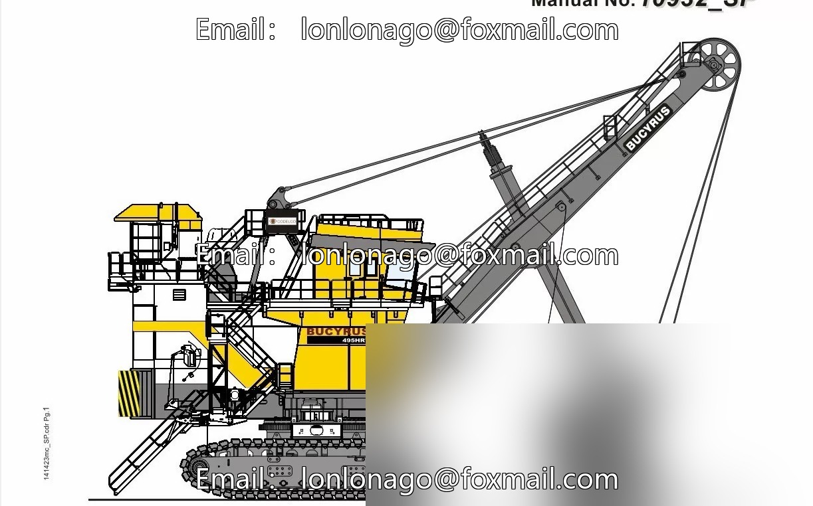
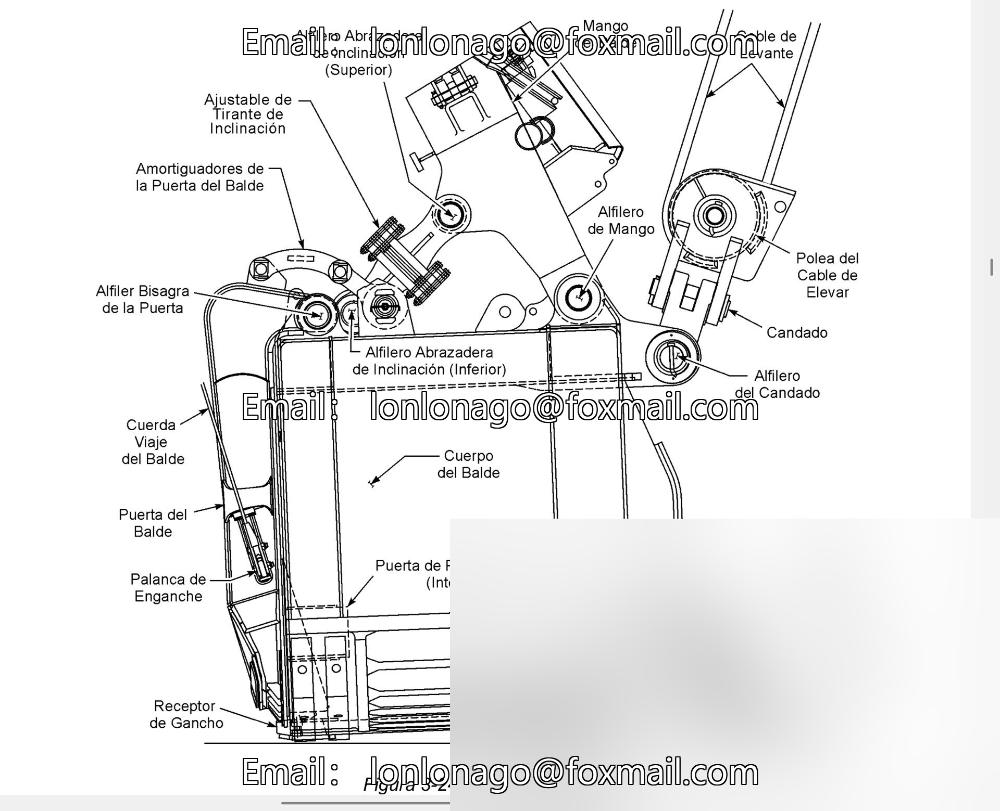
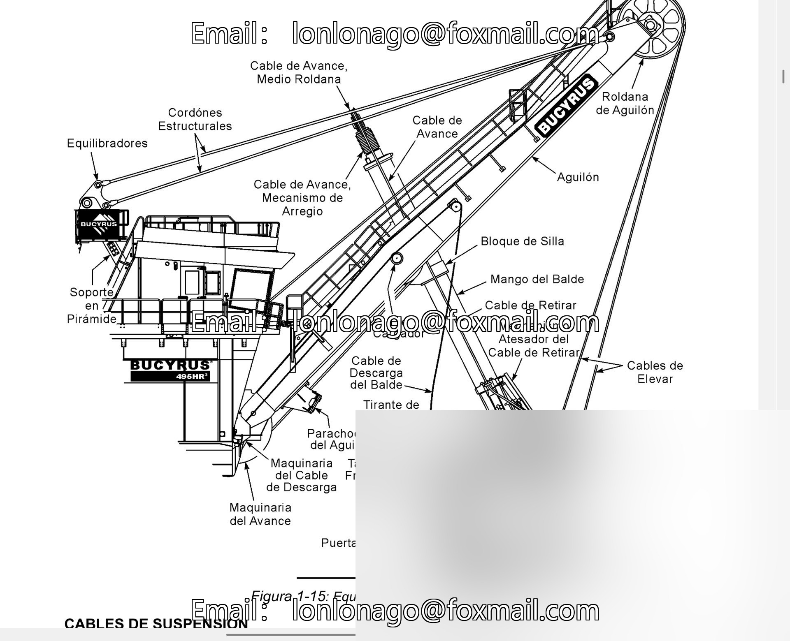
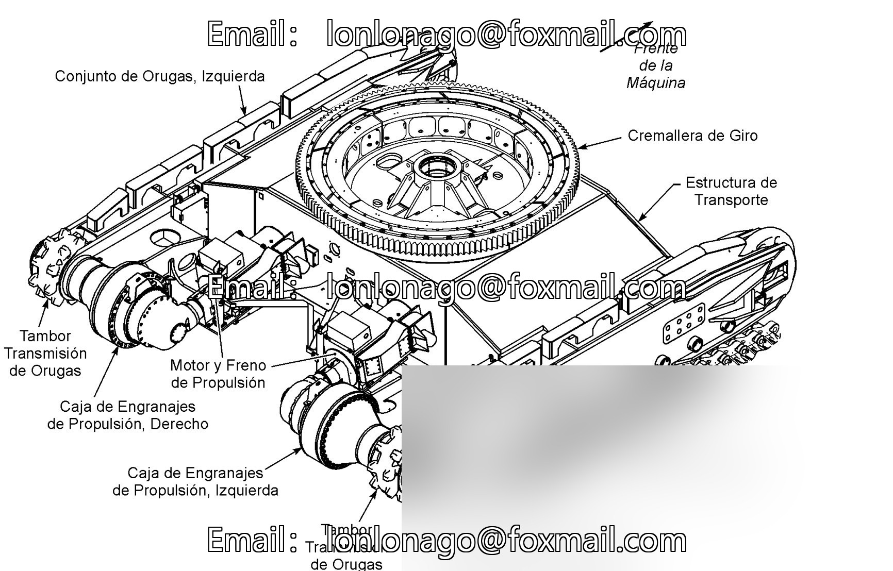

# BUCYRUS excavator design material

## Body

BUCYRUS excavator design materials, BUCYRUS 495HR² excavator maintenance manual PDF , 520 pages, content covers equipment structure, maintenance process, system parameters, etc., suitable for reference for maintenance and upkeep.

The material covers BUCYRUS excavator design, the 495HR² model, maintenance manual PDF, with content on device structure, maintenance procedures, system parameters and related equipment components and operation parameters.

<!-- AI_ENRICHED -->

## Images

## Payment

Here is a pay link on Stripe ( https://buy.stripe.com/3cs8yP7sY87d0vu9AB ). Please contact me lonlonago@foxmail.com after funding $89, and I will send you a complete data files , thank you!

